# Greenhouse Navigation Workspace

ROS1 Noetic catkin 工作空间，包含两个可独立描述的工程项目。

> **生成时间**: 2026-04-29
> **最后更新**: 2026-07-26
> **用途**: 个人工程记录 / 简历素材库

---

## 变更记录 (Changelog)

| 日期 | 变更 |
|------|------|
| 2026-07-26 | 归档外部深度调研《履带车复杂田垄地形导航选型报告》至 `.agentdocs/research/履带车地形导航选型报告.md` — 传感器/算力选型、A–J 全栈方案排序，结论：生产主线维持 FAST-LIO + 增强 CMU 地形 + FAR/FALCO，`FAST_LIO_SUPER` 定位为研究支线 |
| 2026-05-10 | 发现并文档化新增 7 个模块：MoveBase3D（含 10 子包）、graph_decoder、boundary_handler、visibility_graph_msg、dlrobot、dl_msgs、livox_to_pointcloud2；增加 Mermaid 结构图、模块索引表、运行/测试/编码规范/AI指引章节；更新 `.claude/index.json` |
| 2026-04-29 | 初始文档生成 — 12 个模块 |

---

## 项目 A：FAST-LIO Super SLAM — 李群流形上的可插拔 SLAM 系统

**标签**: `C++17` `SLAM` `FAST-LIO2` `Super-LIO` `IMapManager` `INeighborSearch` `OctVoxMap` `HKNN`

### 一句话

将 FAST-LIO2 前端中的 ikd-Tree 地图从**硬编码依赖**解耦为 `IMapManager`/`INeighborSearch` 接口层，并以 Super-LIO 的 OctVoxMap（8-subvoxel 量化 + LRU 淘汰 + HKNN 分层搜索）作为第二个可运行时切换的后端实现。

### 架构设计与接口抽象

在 `FAST_LIO_SUPER/include/slam/` 下设计了两组核心接口，另有一组待实现：

```cpp
// === IMapManager — 地图生命周期 ===
// 调用方（laserMapping.cpp）只依赖此接口，不感知具体后端实现
class IMapManager {
  virtual void configure(const MapConfig&) = 0;           // 读取 yaml slam_core 段
  virtual void insert(const PointVec& world_pts) = 0;      // 增采样插入
  virtual void insertNoDownsample(const PointVec& world_pts) = 0;  // 原始插入
  virtual nn::INeighborSearch& search() = 0;               // 返回关联的邻居搜索器
  virtual CloudPtr snapshot(float voxel = 0.0f) const = 0; // 降采样导出为 PCL Cloud
  virtual void flattenInto(PointVec& out) const = 0;       // 全部点展平
  virtual int removeBoxes(const std::vector<BoundingBox>&) = 0; // 盒状区域删除
  virtual void cropAround(const Eigen::Vector3d&, float radius) = 0; // 空间裁剪
  virtual void drainRemoved(PointVec& out) = 0;            // 取出被删点
  virtual bool empty() const = 0;
  virtual std::size_t size() const = 0;
  virtual std::size_t validSize() const = 0;
  virtual MapStats stats() const = 0;
  virtual const char* name() const = 0;
};

// === INeighborSearch — KNN 搜索 ===
// 每个后端捆绑一个 INeighborSearch 实现
class INeighborSearch {
  // k ≤ 8，输出按 dist2 升序，非阻塞（不得持有跨帧锁）
  virtual int knn(const Query& q, std::array<Neighbor, 8>& out) const = 0;
  // 等价于 FAST-LIO2 的 esti_plane：平面拟合，残差 > 0.1m 返回 valid=false
  virtual bool fitPlane(const Query& q, PlaneCoef& out) const = 0;
  virtual const char* name() const = 0;
};

// 工厂函数 — 运行时按 yaml 选择
std::unique_ptr<IMapManager> makeIkdTreeMap();   // BSD-3 原生后端
std::unique_ptr<IMapManager> makeOctVoxMap();    // GPLv3 Super-LIO 后端
```

### 两个后端的工程实现

#### 后端 1：IkdTreeMap（Phase A）

**ikd-Tree 原生后端的接口适配**。将原 `laserMapping.cpp` 中所有全局 `ikdtree` 对象调用迁移到 `slamMap()`：

| 原调用 | IMapManager 方法 | 说明 |
|--------|-------------------|------|
| `ikdtree.Add_Points(pts, true)` | `insert(pts)` | 降采样后插入 |
| `ikdtree.Add_Points(pts, false)` | `insertNoDownsample(pts)` | 原始插入 |
| `ikdtree.Delete_Point_Boxes(box, true)` | `removeBoxes(boxes)` | `BoxPointType` → `BoundingBox` 转换 |
| `ikdtree.acquire_removed_points(pts)` | `drainRemoved(pts)` | 取出被 ikd-Tree 惰性删除的点 |
| `ikdtree.flatten(pts)` | `flattenInto(pts)` | 全量导出 |
| `ikdtree.Root_Node == nullptr` | `empty()` | 判空 |
| `ikdtree.validnum` | `validSize()` | 有效点数 |
| `ikdtree.size()` | `size()` | 含无效点总数 |
| `ikdtree.Build()` | `insert()` 首次调用 | 触发内部 Build |

新增 `fast_lio_super_slam` 静态库 target，`fastlio_super_mapping` 链接到此库。

#### 后端 2：OctVoxMap（Phase B-1）

**从 Super-LIO 源码中提取核心层**，封装为 IMapManager 适配器。

**Vendored 文件清单**（`slam_octvox` 包，header-only，GPLv3）：

| 文件 | 修改 |
|------|------|
| `OctVoxMap.hpp` | 删 `<execution>`（未使用）/ `<filesystem>` / `saveMap()` 方法 |
| `HKNN_list60_gem.h` | 无修改 |
| `tsl/robin_map.h` + `robin_growth_policy.h` | MIT 许可，无修改 |

**OctVox 空间量化公式**：

```cpp
fine_key = floor(pt * (2 / resolution));  // 双倍分辨率的 sub-voxel 格
key      = fine_key >> 1;                 // 父 voxel 坐标
local_idx = (dz << 2) | (dy << 1) | dx;  // 八分体索引 0..7
```

- 每 voxel 持 8 个 octant，`MAX_POINTS_PER_SUBVOXEL = 20`
- `DISTANCE_THRESHOLD_SQ = 0.01`（0.1m²） — 新点与 running mean 距离超标则拒绝
- 更新公式：`stored = (stored * count + pt) / (count + 1)`
- LRU：`std::list<pair<KEY, OctVox>>` + `tsl::robin_map<KEY, iter>`，容量超限淘汰末尾

**HKNN 分层搜索**：搜索表被分为 6 组，共 593 条预计算条目：

```
flat_search_order_offsets[7] = {0, 43, 135, 219, 321, 465, 593}
```

- Group0：访问当前 voxel 的 8 个 octant
- Groups 1-5：访问 `HKNN_neighbor_voxel[60]` 的外围 voxel
- Mirror 优化：`n_key = key + mirror_axis * HKNN_neighbor_voxel[i]`
- XOR 优化：`_local_idx = table_local_idx ^ local_idx`
- Top-8 voxel 缓存：Group0 结果后续组复用
- **早停阈值**：`{0.0625, 0.125, 0.25, 0.3125, 0.375, 100}` m²（平方距离）

#### Phase B-1.c：锁优化与并行调优

- HKNN 热路径中移除了跨帧 `mutex` 锁（查询无写竞争，只需内存序保证）
- 运行时 OMP 线程数动态可调，不再编译期硬编码

### 后端切换配置

```yaml
# config/mid360.yaml
slam_core:
  map_backend: "octvox"   # "ikdtree" | "octvox"
```

运行时不需重启节点，`laserMapping.cpp::main()` 启动时读取此字段调用工厂函数。

### LaserMapping.cpp 迁移（原 FAST-LIO2 主节点）

全局变量 `ikdtree` 被完全删除。所有地图操作用 `slamMap()` 单例取代：

```cpp
// 迁移前
ikdtree.Add_Points(point_wait_insert, false);
// 迁移后
slamMap().insertNoDownsample(point_wait_insert);

// 迁移前
ikdtree.Delete_Point_Boxes(Box, true);
// 迁移后
std::vector<BoundingBox> boxes{box};
slamMap().removeBoxes(boxes);

// 迁移前
ikdtree.acquire_removed_points(remove_points);
// 迁移后
slamMap().drainRemoved(remove_points);
```

### C++17 全包升级

- `FAST_LIO_SUPER` 和 `slam_octvox` 的 `CMakeLists.txt` 从 C++14 升至 C++17
- 利用 C++17 `std::optional`、结构化绑定、`if constexpr` 等特性优化后端代码

### Docker 编译

```bash
docker pull hkustswj/fastlivo-dev:noetic-ros-base
# 容器内 catkin_make --only-pkg-with-deps fast_lio_super 通过
```

### 技术调研体系（12+ 份深度文档）

以下是你为 Phase C 后端所做决策撰写的技术文档链。按依赖顺序排列：

| 文档 | 技术内容 | 结论 |
|------|----------|------|
| `ARCHITECTURE.md` | 分层架构图（ROS 层 / slam_core / 3 个后端 + 2 个占位接口）+ 目录布局 + CMake target 拓扑 + ROS 层契约（节点名/pkg/launch 不改） | 组合矩阵：IkdTree / OctVox / (待实现)Relocalizer |
| `ITERATION_PLAN.md` | 逐 Phase 的 [x] 完成 / [ ] 待办清单 + 退出条件定义 | 当前 Phase B-1 完成；C-1 最小切面 = keyframe + 相邻因子 + iSAM2 + map correction bridge |
| `SLAM_CORE_API.md` | `IMapManager` 13 方法 + `INeighborSearch` 3 方法 + `Neighbor::dist2` 语义 + `fitPlane` 残差 0.1m 阈值 + 线程安全约定 | 接口冻结，实现方可自由替换 |
| `SUPERLIO_REFERENCE_NOTES.md` | OctVox 8-subvoxel 空间量化公式、LRU 淘汰容量限制、running mean 更新策略、HKNN 6 组 593 条分层搜索表、早停 dist2 阈值、mirror/XOR 优化、resetMap 10 帧保护期 | 精确到具体常数，全部可引用 |
| `BACKEND_SELECTION_REPORT_V2.md` | 20+ 仓库候选池对比、v1 vs v2 结论修正、"拼装式系统工程"路线论证、Mid360 林地下回环方案分析 | 不走三选一；选 small_gicp as loop verifier；重定位走 LiLoc |
| `C1_BACKEND_SKELETON.md` | 5 锁架构（realtime_pose / keyframes / graph / verify_buf / vis）、`PosePcd` 数据结构、GTSAM ISAM2 更新拓扑、loop candidate queue backpressure 阈值（size>30 warn） | 参考 FAST-LIO-SAM 骨架图纸 + SC-PGO 两阶段升级 |
| `LOOP_VERIFIER_SELECTION.md` | small_gicp API 示例（`voxelgrid_sampling_omp` / `KdTree` / `RegistrationResult`）vs nano_gicp API（`setMaxCorrespondenceDistance` / `getFitnessScore`）逐行对比 + 编译依赖表、CI/测试/维护者状态 | **选 small_gicp**（MIT, C++17, 完整 CI, TBB+OpenMP, 10x 代码量） |
| `SC_PGO_COMPARISON.md` | 两阶段 loop pipeline 结构：`process_lcd(1Hz)` → queue → `process_icp(background)` → `process_isam` + Cauchy robust kernel + 各向异性 noise 建模 | SC-PGO 在 loop pipeline 和 noise 建模上显著优于 FAST-LIO-SAM |
| `LILOC_EVALUATION.md` | LiLoc 文件逐行分析（7288 行中 82% 是 LIO-SAM 基础设施，仅 18% 创新）+ 依赖链红灯（livox_driver v1 不兼容、better_fastlio2 GPL-2.0） | 不整包引入，只借 `egoOptimization`(650 行) + `dataManager`(691 行) 两模块 |
| `CLONE_AUDIT.md` | 16 仓库的 License 逐项核实 + GPLv2-only 与 GPLv3 不兼容（FSF FAQ 引用）+ CC-NC 商业化红线 + `git clone` TLS bug 修法（`http.version HTTP/1.1` + `postBuffer 1GB`） | 3 组 GPL-2.0/CC-NC 不可并库；MIT/BSD/MPL/GPLv3 可直接用 |
| `CHATGPT_DEEP_RESEARCH_BRIEFING.md` | 给 LLM 的完整上下文包：当前工程状态、Phase A/B 完成情况、slam_core 接口签名、具体 30 个调研问题 | — |
| `DEEP_RESEARCH_REPORT_V2.md` | ChatGPT 对 30 个问题的详细回复 — 系统级选型建议、"三图分离"论证、ROS2 迁移策略 | 验证了"拼装式系统工程"路线 |

---

## 项目 B：温室自主导航系统 — CMU / FAR Planner 生态全栈管线缝合

**标签**: `ROS1 Noetic` `Navigation Stack` `Mid360 LiDAR` `FAR-Planner` `CMU Terrain Analysis` `Elevation Map` `Visibility Graph` `履带底盘`

### 一句话

以 Mid360 为核心传感器，在履带底盘上缝合 CMU CARLA 生态的局部高程地图（双层体素 + 分位数地面估计 + 滚动栅格 + 时间衰减）、FAR Planner 的可视图全局规划、CMU Local Planner 的局部规划与路径跟踪，完成从传感器驱动、状态估计、高程地图构建、全局/局部规划到底盘串口执行的全栈导航管线集成。

### 缝合的算法

你从 CMU / CARLA 自动驾驶生态中提取并装配了以下算法链：

| 算法 | 来源 | 你在本仓库中的集成 |
|------|------|-------------------|
| **Elevation Mapping** | CMU terrain_analysis | 双层体素 (1.0m terrainVoxel + 0.2m planarVoxel)、分位数 (25%) 地面估计、滚动栅格移位、动态障碍物检测、时间衰减 (2s vs 10s) |
| **FAR Planner** | CMU FAR Planner | 可视图全局规划 (14 headers + 9 sources)，visibility graph A*，地形 cost 感知 |
| **CMU Local Planner** | CMU 局部规划器 | Trajectory Rollout 局部避障 + pathFollower 速度跟踪 |
| **FAST-LIO2** | HKU/MaRS | IESKF 前端里程计，作为导航管线的状态估计引擎 |

### 你的产出

| 类别 | 内容 |
|------|------|
| 算法集成 | 缝合 FAST-LIO2 前端里程计 + CMU 双层高程地图 + FAR 可视图全局规划 + CMU 局部规划 + 底盘控制的完整导航管线 |
| 传感器补偿 | Mid360 前下倾 27° — 不修改 FAST-LIO 内部坐标系，通过额外发布水平辅助帧 `robot_foot_init`/`body_foot` 兼容下游 |
| 双图层高程图 | 两个 CMU terrain_analysis 实例并行：快衰减(2s)+分位数地面→local 避障，慢衰减(10s)+minZ 地面→global 远距离规划 |
| 滚动栅格 | 21×21 terrainVoxel (1.0m) + 51×51 planarVoxel (0.2m)，环形缓冲区移位避免重建 |
| 系统集成 | 设计 4 个一键启动入口（建图 + 正向/反向导航），3 层 launch 装配 |
| 定位 + 桥接 | Python 定位管理器协调 FAST-LIO 与全局重定位，cmd_vel_stamped_bridge 做 TwistStamped→Twist 转换 |

### 传感器外参补偿：Mid360 前下倾 27°

**问题**：Mid360 安装时绕 Y 轴前下倾 27°，若保留 FAST-LIO 原生 `camera_init` 帧，RViz 中看到的 `/cloud_registered` 是倾斜的，与下游导航模块期望的水平坐标系不一致。

**你的解决方案** — 不修改 FAST-LIO 内部坐标语义，额外发布水平辅助帧：

```
# static TF transforms
body → body_foot                    # 局部水平补偿
camera_init → robot_foot_init      # 世界帧水平补偿

pitch = -27° = -0.471239 rad       # 绕 Y 轴旋转
```

- **不塞进** `livox_ros_driver2` 的 `extrinsic_parameter` 或 `FAST_LIO/config/mid360.yaml` 的 `extrinsic_R/T`
- **收敛到** `greenhouse_nav/launch/system_greenhouse_base.launch` + `localization_manager.py`
- 建图入口默认为 `Fixed Frame = robot_foot_init`（水平辅助世界帧）
- `/state_estimation` 与 `base_link` 兼容现有导航下游

### Launch 装配层次

**3 层 launch 结构**：

```
用户入口层                   建图 / 导航 / 正向 / 反向
                                │
内部装配层              system_greenhouse_base.launch (外参+辅助帧)
                       system_greenhouse_with_route_planner.launch (完整规划)
                       system_greenhouse_bag.launch (回放)
                                │
模块层                  livox_ros_driver2 / FAST_LIO / terrain_analysis / ...
```

**4 个用户入口**：

| 入口 | 命令 | 底层差异 |
|------|------|----------|
| 建图 | `greenhouse_mapping.launch` | 只启 FAST-LIO，不启 localization/planner |
| 导航 | `greenhouse_navigation.launch` | 启全套，默认正向 |
| 正向导航 | `greenhouse_navigation_forward.launch` | `body → base_link` yaw = 0 |
| 反向导航 | `greenhouse_navigation_reverse.launch` | `body → base_link` yaw = π |

### 数据流合约

```
Mid360 (CustomMsg)
  → livox_ros_driver2 → /livox/lidar + /livox/imu
  → FAST_LIO → /Odometry + /cloud_registered
  → FAST_LIO_LOCALIZATION → /state_estimation (map→base_link)
  → greenhouse_nav/localization_manager (Python, 协调/重映射)

far_planner:
  订阅: /cloud_registered + /terrain_map + /terrain_map_ext + /goal_point
  发布: /way_point (全局路径点序列) + /navigation_boundary (可通行边界)

local_planner (CMU) + pathFollower:
  订阅: /state_estimation + /way_point + /navigation_boundary + /terrain_map
  发布: /path (局部路径) + /cmd_vel_stamped (带时间戳速度指令)

cmd_vel_stamped_bridge (Python):
  订阅: /cmd_vel_stamped → 发布: /cmd_vel (geometry_msgs/Twist)

dlrobot_robot (C++11):
  订阅: /cmd_vel
  输出: 串口底盘指令 (serial 库)
```

### 各模块技术细节

#### FAR Planner（14 头文件 + 9 源文件）

`include/far_planner/` 下 14 个头文件定义的数据结构：

| 头文件 | 核心类型 |
|--------|----------|
| `node_struct.h` | 可视图节点（位置、邻接链表、cost） |
| `point_struct.h` | 点云体素结构 |
| `dynamic_graph.h` | 动态图增删边操作 |
| `graph_planner.h` | A* / Dijkstra 规划器 |
| `contour_detector.h` | 障碍物轮廓检测 |
| `contour_graph.h` | 轮廓图拓扑 |
| `map_handler.h` | 点云 → costmap 转换 |
| `scan_handler.h` | 激光扫描数据管理 |
| `terrain_planner.h` | 地形感知规划 |
| `grid.h` | 栅格化工具 |
| `intersection.h` | 线段求交/碰撞检测 |
| `planner_visualizer.h` | RViz Marker 可视化 |
| `graph_msger.h` | 消息序列化/通信 |
| `time_measure.h` | 性能计时 |
| `utility.h` | 通用数学工具 |
| `far_planner.h` | 主类声明 |

#### CMU Local Planner

两个独立可执行：

- `localPlanner`：订阅全局路径 + 地形图，基于 DWA/Trajectory Rollout 生成局部路径
- `pathFollower`：跟踪局部路径，输出 `cmd_vel_stamped`

正反向模式控制：`greenhouse_nav` launch 中通过 `body → base_link` 的 yaw 偏移（0 vs π）修正底盘朝向。

#### Terrain Analysis（双图层并行）

```
terrain_analysis      → /terrain_map      (单帧地形分类)
terrain_analysis_ext  → /terrain_map_ext  (扩展参数/粒度)
```

两者订阅 `/cloud_registered`，并行运行，为规划器提供不同参数的地形图层。

#### dlrobot_robot 底盘执行

- C++11 节点 `dlrobot_robot_node`：订阅 `/cmd_vel`，串口发送底盘控制指令
- `Quaternion_Solution.cpp`：姿态四元数解算
- `scripts/dlrobot_udev.sh`：串口设备 udev 权限规则配置
- `urdf/`：底盘 URDF 模型（供 RViz 可视化 + TF 树）
- 串口通信依赖 `serial` 库

---

## 两个项目的关系

```
项目 B（温室导航——全栈集成）               项目 A（FAST-LIO Super SLAM——核心算法引擎）
───────────────────────────────            ───────────────────────────────────────
greenhouse_nav (launch + 桥接)             FAST_LIO_SUPER (slam_core 接口 + 后端)
  └─ FAST_LIO (baseline 里程计) ──→               └─ IkdTreeMap (等价替换)
                                                    └─ OctVoxMap (Super-LIO 集成)
  └─ FAST_LIO_LOCALIZATION (重定位)
  └─ far_planner (全局规划)                         🔗 FAST_LIO_SUPER 完成后
  └─ local_planner (局部规划)                        可替换项目 B 中的 FAST_LIO
  └─ terrain_analysis (地形)                        成为新的状态估计引擎
  └─ dlrobot_robot (底盘)
  └─ livox_ros_driver2 (传感器驱动)
```

---

## 模块结构图 (Mermaid)

```mermaid
graph TD
    ROOT["(根) Greenhouse Navigation Workspace"] --> PROJA["项目 A: FAST-LIO Super SLAM"];
    ROOT --> PROJB["项目 B: 温室自主导航系统"];
    ROOT --> AUX["辅助/备选模块"];

    PROJA --> FAST_LIO_SUPER["FAST_LIO_SUPER<br/>slam_core 接口 + 双后端"];
    PROJA --> slam_octvox["slam_octvox<br/>Vendored OctVoxMap + HKNN"];

    PROJB --> greenhouse_nav["greenhouse_nav<br/>系统集成 + launch 装配"];
    PROJB --> FAST_LIO["FAST_LIO<br/>原版 FAST-LIO2 baseline"];
    PROJB --> FAST_LIO_LOCALIZATION["FAST_LIO_LOCALIZATION<br/>全局重定位 (GPL-2.0)"];
    PROJB --> livox_ros_driver2["livox_ros_driver2<br/>Mid360 雷达驱动"];
    PROJB --> terrain_analysis["terrain_analysis<br/>高程地图 (快衰减)"];
    PROJB --> terrain_analysis_ext["terrain_analysis_ext<br/>高程地图 (慢衰减)"];
    PROJB --> far_planner["far_planner<br/>可视图全局规划"];
    PROJB --> local_planner["local_planner<br/>局部规划 + pathFollower"];
    PROJB --> dlrobot_robot["dlrobot_robot<br/>底盘串口执行"];
    PROJB --> global_to_local_adapter["global_to_local_adapter<br/>路径适配 (预留)"];

    AUX --> MoveBase3D["MoveBase3D<br/>3D 导航套件 (10 子包)"];
    AUX --> graph_decoder["graph_decoder<br/>可视图解码器"];
    AUX --> boundary_handler["boundary_handler<br/>边界图提取器"];
    AUX --> dlrobot["dlrobot<br/>差速底盘 (rosserial)"];
    AUX --> livox_to_pc2["livox_to_pointcloud2<br/>CustomMsg → PCL2"];

    subgraph MSG_DEFS["消息定义包"]
        visibility_graph_msg["visibility_graph_msg<br/>可视图消息"]
        dl_msgs["dl_msgs<br/>底盘消息 (14 种)"]
    end

    click ROOT "./CLAUDE.md" "返回根文档"
    click FAST_LIO_SUPER "./src/FAST_LIO_SUPER/CLAUDE.md" "查看 FAST_LIO_SUPER 文档"
    click slam_octvox "./src/slam_octvox/CLAUDE.md" "查看 slam_octvox 文档"
    click greenhouse_nav "./src/greenhouse_nav/CLAUDE.md" "查看 greenhouse_nav 文档"
    click FAST_LIO "./src/FAST_LIO/CLAUDE.md" "查看 FAST_LIO 文档"
    click FAST_LIO_LOCALIZATION "./src/FAST_LIO_LOCALIZATION/CLAUDE.md" "查看 FAST_LIO_LOCALIZATION 文档"
    click livox_ros_driver2 "./src/livox_ros_driver2/CLAUDE.md" "查看 livox_ros_driver2 文档"
    click terrain_analysis "./src/terrain_analysis/CLAUDE.md" "查看 terrain_analysis 文档"
    click terrain_analysis_ext "./src/terrain_analysis_ext/CLAUDE.md" "查看 terrain_analysis_ext 文档"
    click far_planner "./src/far_planner/CLAUDE.md" "查看 far_planner 文档"
    click local_planner "./src/local_planner/CLAUDE.md" "查看 local_planner 文档"
    click dlrobot_robot "./src/dlrobot_robot/CLAUDE.md" "查看 dlrobot_robot 文档"
    click global_to_local_adapter "./src/global_to_local_adapter/CLAUDE.md" "查看 global_to_local_adapter 文档"
    click MoveBase3D "./src/MoveBase3D/CLAUDE.md" "查看 MoveBase3D 文档"
    click graph_decoder "./src/graph_decoder/CLAUDE.md" "查看 graph_decoder 文档"
    click boundary_handler "./src/boundary_handler/CLAUDE.md" "查看 boundary_handler 文档"
    click dlrobot "./src/dlrobot/CLAUDE.md" "查看 dlrobot 文档"
    click livox_to_pc2 "./src/livox_to_pointcloud2/CLAUDE.md" "查看 livox_to_pointcloud2 文档"
    click visibility_graph_msg "./src/visibility_graph_msg/CLAUDE.md" "查看 visibility_graph_msg 文档"
    click dl_msgs "./src/dl_msgs/CLAUDE.md" "查看 dl_msgs 文档"
```



---

## 模块索引

| 模块路径 | 项目 | 标签 | 职责 | 文档 |
|----------|------|------|------|------|
| `src/FAST_LIO_SUPER` | ★ A | `C++17` `SLAM` `IMapManager` `OctVox` | slam_core 接口抽象 + IkdTree/OctVox 双后端 | [CLAUDE.md](./src/FAST_LIO_SUPER/CLAUDE.md) |
| `src/slam_octvox` | ★ A | `GPLv3` `Header-only` `HKNN` | Vendored OctVoxMap + HKNN 搜索 | [CLAUDE.md](./src/slam_octvox/CLAUDE.md) |
| `src/greenhouse_nav` | B | `Launch` `TF` `Python` | 系统集成入口、launch 装配、外参补偿 | [CLAUDE.md](./src/greenhouse_nav/CLAUDE.md) |
| `src/FAST_LIO` | B | `C++14` `IESKF` `ikd-Tree` | 原版 FAST-LIO2 baseline（对照） | [CLAUDE.md](./src/FAST_LIO/CLAUDE.md) |
| `src/FAST_LIO_LOCALIZATION` | B | `GPL-2.0` `C++14` `Python` | 全局重定位（License 受限） | [CLAUDE.md](./src/FAST_LIO_LOCALIZATION/CLAUDE.md) |
| `src/livox_ros_driver2` | B | `C/C++` `Livox` `Driver` | Mid360 雷达驱动（官方无修改） | [CLAUDE.md](./src/livox_ros_driver2/CLAUDE.md) |
| `src/terrain_analysis` | B | `C++` `Elevation Map` | 双层体素高程地图（快衰减） | [CLAUDE.md](./src/terrain_analysis/CLAUDE.md) |
| `src/terrain_analysis_ext` | B | `C++` `Elevation Map` | 扩展高程地图（慢衰减） | [CLAUDE.md](./src/terrain_analysis_ext/CLAUDE.md) |
| `src/far_planner` | B | `C++14` `Visibility Graph` `A*` | FAR 可视图全局规划 | [CLAUDE.md](./src/far_planner/CLAUDE.md) |
| `src/local_planner` | B | `C++` `Trajectory Rollout` | CMU 局部规划 + pathFollower | [CLAUDE.md](./src/local_planner/CLAUDE.md) |
| `src/dlrobot_robot` | B | `C++11` `serial` `URDF` | 底盘串口执行器 | [CLAUDE.md](./src/dlrobot_robot/CLAUDE.md) |
| `src/global_to_local_adapter` | B | `Python` | 路径适配器（预留未启用） | [CLAUDE.md](./src/global_to_local_adapter/CLAUDE.md) |
| `src/livox_to_pointcloud2` | B | `C++` `PCL` `Converter` | CustomMsg → PointCloud2 转换 | [CLAUDE.md](./src/livox_to_pointcloud2/CLAUDE.md) |
| `src/MoveBase3D` | 备选 | `C++` `Python` `RViz` | 3D 导航套件（10 子包） | [CLAUDE.md](./src/MoveBase3D/CLAUDE.md) |
| `src/graph_decoder` | 备选 | `C++` `PCL` | 可视图消息解码器 | [CLAUDE.md](./src/graph_decoder/CLAUDE.md) |
| `src/boundary_handler` | 备选 | `C++` `PCL` `Boundary` | 边界图提取器 | [CLAUDE.md](./src/boundary_handler/CLAUDE.md) |
| `src/visibility_graph_msg` | 通用 | `ROS Msg` | 可视图消息定义 | [CLAUDE.md](./src/visibility_graph_msg/CLAUDE.md) |
| `src/dlrobot` | 备选 | `C++` `rosserial` | 差速底盘驱动（前代参考） | [CLAUDE.md](./src/dlrobot/CLAUDE.md) |
| `src/dl_msgs` | 通用 | `ROS Msg` `Srv` | 底盘自定义消息(14种)+服务 | [CLAUDE.md](./src/dl_msgs/CLAUDE.md) |

---

## 运行与开发

### 环境要求

- ROS1 Noetic (Ubuntu 20.04)
- C++14/17 编译器 (GCC 9+)
- PCL ≥ 1.8
- Eigen3
- Livox SDK (内置于 livox_ros_driver2)

### 构建

```bash
source /opt/ros/noetic/setup.bash
cd /mnt/d/test_move3d/test_move3d
catkin_make
# 或指定单包:
catkin_make --only-pkg-with-deps fast_lio_super
```

### Docker 开发环境

```bash
docker pull hkustswj/fastlivo-dev:noetic-ros-base
# 或自行构建 Dockerfile
```

### 工作流

**项目 A — SLAM 后端调试**:
```bash
roslaunch fast_lio_super mapping_mid360.launch
# 切换后端: 编辑 config/mid360.yaml → slam_core.map_backend: "ikdtree" | "octvox"
```

**项目 B — 温室导航**:
```bash
# 建图模式
roslaunch greenhouse_nav greenhouse_mapping.launch
# 导航模式（正向）
roslaunch greenhouse_nav greenhouse_navigation.launch
# 导航模式（反向）
roslaunch greenhouse_nav greenhouse_navigation_reverse.launch
```

### 关键文件索引

| 文件 | 用途 |
|------|------|
| `src/FAST_LIO_SUPER/src/laserMapping.cpp` | SLAM 主循环入口 |
| `src/FAST_LIO_SUPER/include/slam/map/map_manager.hpp` | IMapManager 接口定义 |
| `src/FAST_LIO_SUPER/include/slam/nn/neighbor_search.hpp` | INeighborSearch 接口定义 |
| `src/greenhouse_nav/launch/greenhouse_navigation.launch` | 导航启动入口 |
| `src/greenhouse_nav/scripts/localization_manager.py` | 定位管理器 |
| `src/far_planner/src/far_planner.cpp` | 全局规划主类 |
| `src/terrain_analysis/src/terrainAnalysis.cpp` | 地形分析主算法 |

---

## 测试策略

当前仓库的测试覆盖情况：

| 类型 | 状态 | 说明 |
|------|------|------|
| 单元测试 | 未覆盖 | 项目中无 gtest/rostest 用例 |
| 集成测试 | 有限 | 通过 Docker 内 roslaunch 手动验证 |
| 调研验证 | 12+ 文档 | FAST_LIO_SUPER/docs/ 中含 Docker 编译/runtime 验证日志 |
| 运行验证 | .agentdocs/runtime/ | 包含 far_planner 各阶段 runtime diagnostics 记录 |

### 推荐测试切入点

1. **slam_core 接口测试**：编写 gtest 用例 mock IMapManager/INeighborSearch，验证 laserMapping.cpp 调用契约
2. **后端一致性测试**：相同输入下 IkdTreeMap vs OctVoxMap 的 insert/knn 输出差异（容许 <1%）
3. **集成烟雾测试**：Docker 内 roslaunch + rostopic echo 验证 topic 连通性
4. **回环回归**：使用 .bag 文件 replay 验证导航管线各模块 topic 流

---

## 编码规范

### C++

- **项目 A** (`FAST_LIO_SUPER`, `slam_octvox`)：C++17，使用 `std::optional`、结构化绑定、`if constexpr`
- **项目 B** 算法模块 (`far_planner`, `local_planner`, `terrain_analysis`)：C++14
- **FAST_LIO/FAST_LIO_LOCALIZATION**：C++14（上游原始标准）
- **dlrobot_robot**：C++11
- 命名空间：项目 A 使用 `slam::map::`, `slam::nn::`；项目 B 使用 `far_planner::` 等
- 头文件：优先 `.hpp` 用于模板/header-only；`.h` 用于传统 C 兼容

### Python

- 目标 Python 3.x（ROS1 Noetic 默认 Python 3）
- 脚本式节点不做类抽象，保证可读性
- ROS launch XML 优先使用 `$(find ...)` 路径引用

### 通用

- CMakeLists.txt 中保持 `catkin_make` 兼容，不引入非 catkin 构建系统
- 不修改上游仓库（FAST_LIO, livox_ros_driver2 等）的原始 API/topic/参数契约

---

## AI 使用指引

本项目为个人工程记录/简历素材库，大量调研文档由 AI 辅助生成。

### CLAUDE.md 维护规则

1. **增量更新**：不覆盖已有内容，只追加/修正
2. **模块结构**：每次扫描需更新 Mermaid 图 + 模块索引表
3. **覆盖率**：记录已扫描/未扫描模块并说明原因
4. **时间戳**：生成/更新时间使用 ISO-8601 格式

### 推荐扫描流程

```
Phase A (全仓清点) → Phase B (模块扫描) → Phase C (深度补捞) → 更新文档
```

### 重要约束

- 不修改源代码，仅生成/更新文档与 `.claude/index.json`
- 忽略规则：优先读取 `.gitignore`，若无则使用默认规则
- 对二进制/大文件只记录路径，不读内容
- 若分页/调用达到上限，提前写出部分结果并在摘要中说明

---

## 项目结构

```
test_move3d/
├── CLAUDE.md                      # ← 本文（根级文档）
│
├── src/                           # ROS catkin 包集合
│   │
│   ├── ★ 项目 A：SLAM 核心引擎
│   │   ├── FAST_LIO_SUPER/        # FAST-LIO Super（C++17, GPLv3, slam_core 接口 + 双后端）
│   │   └── slam_octvox/           # Vendored OctVoxMap + HKNN（GPLv3, header-only）
│   │
│   ├── ★ 项目 B：温室导航系统
│   │   ├── greenhouse_nav/        # 系统集成（launch/Python 桥接）
│   │   ├── FAST_LIO/              # FAST-LIO2 baseline（C++14, BSD-3）
│   │   ├── FAST_LIO_LOCALIZATION/ # 全局重定位（GPL-2.0, 设计参考）
│   │   ├── livox_ros_driver2/     # Mid360 雷达驱动（官方无修改）
│   │   ├── terrain_analysis/      # 高程地图（快衰减, local 避障）
│   │   ├── terrain_analysis_ext/  # 高程地图（慢衰减, global 规划）
│   │   ├── far_planner/           # FAR 可视图全局规划（14 headers + 9 sources）
│   │   ├── local_planner/         # CMU 局部规划 + pathFollower
│   │   ├── dlrobot_robot/         # 底盘串口执行（C++11）
│   │   ├── global_to_local_adapter/ # 路径适配（预留未启用）
│   │   └── livox_to_pointcloud2/  # CustomMsg → PointCloud2 转换
│   │
│   ├── 辅助/备选模块
│   │   ├── MoveBase3D/            # 3D 导航套件（含 10 子包）
│   │   ├── graph_decoder/         # 可视图解码器
│   │   ├── boundary_handler/      # 边界图提取器
│   │   ├── dlrobot/               # 差速底盘（rosserial 方案）
│   │   │
│   │   └── 消息定义包
│   │       ├── visibility_graph_msg/    # 可视图消息定义
│   │       └── dl_msgs/                # 底盘消息定义（14 种 msg + srv）
│   │
│   ├── .agentdocs/                # 温室方案与计划（含 runtime diagnostics）
│   └── src/FAST_LIO_SUPER/docs/   # ★ 项目 A：调研报告集合（12+ 份）
```
