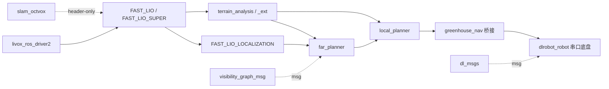

# Workspace 总方案概览（OVERVIEW）

> ROS1 Noetic catkin 工作空间，包含两条主线：
> **项目 A — FAST-LIO Super SLAM**（可插拔地图后端的 SLAM 引擎研究线）与
> **项目 B — 温室自主导航系统**（Mid360 + CMU/FAR 生态的全栈导航生产线）。
> 本文回答四个问题：用了哪些包、上游在哪、有没有魔改、整体技术路线。
> 接口签名 / topic / TF / 命名细节见 `.trellis/spec/backend/`，此处不重复。

---

## 1. 整体技术路线

### 1.1 SLAM 线（项目 A，研究/替换线）

```
Mid360 (CustomMsg + IMU)
  → livox_ros_driver2
  → FAST_LIO_SUPER (IESKF 前端, C++17)
       └─ IMapManager / INeighborSearch 接口层（ikd-Tree 依赖解耦）
            ├─ 后端 1: IkdTreeMap  （原生 ikd-Tree 适配）
            └─ 后端 2: OctVoxMap   （slam_octvox: vendored Super-LIO, HKNN 搜索）
  → /Odometry + /cloud_registered  （ROS 契约与 FAST-LIO2 完全一致）
```

后端通过 `config/mid360.yaml` 的 `slam_core.map_backend: "ikdtree" | "octvox"`
运行时选择。后续 Phase C 规划 keyframe + iSAM2 回环后端（尚未实现）。

### 1.2 导航线（项目 B，当前生产线）

```
Mid360 → livox_ros_driver2 → /livox/lidar + /livox/imu
  → FAST_LIO（baseline 里程计）→ /Odometry + /cloud_registered
  → FAST_LIO_LOCALIZATION（预建图重定位）→ /state_estimation
  → terrain_analysis（快衰减）+ terrain_analysis_ext（慢衰减）→ /terrain_map(_ext)
  → far_planner（可视图全局规划）→ /way_point
  → local_planner + pathFollower（局部规划/跟踪）→ /cmd_vel_stamped
  → greenhouse_nav/cmd_vel_stamped_bridge → /cmd_vel
  → dlrobot_robot（串口底盘执行）
```

`greenhouse_nav` 是系统装配层：launch 三层结构、Mid360 前下倾 27° 外参补偿
（发布水平辅助帧，不改 FAST-LIO 内部坐标系）、Python 定位管理与桥接。
项目 A 完成后，`fast_lio_super` 可原位替换导航线中的 `FAST_LIO`
（ROS 契约保持一致，launch 无需改动）。

---

## 2. 包清单（上游 / 是否魔改）

### 2.1 SLAM 主线（项目 A）

| 包 | 上游 | 魔改? | 改动摘要 |
|---|---|---|---|
| `FAST_LIO_SUPER` | fork 自 https://github.com/hku-mars/FAST_LIO | **重度魔改** | 删除全局 `ikdtree` 硬编码，抽象为 IMapManager/INeighborSearch 接口 + 双后端工厂；全包升级 C++17；HKNN 热路径去锁、OMP 运行时调优 |
| `slam_octvox` | vendored 自 https://github.com/Liansheng-Wang/Super-LIO | 轻度魔改 | 仅提取 OctVoxMap.hpp + HKNN 表 + tsl/robin_map；删 `<execution>`/`<filesystem>`/`saveMap()`，新增 3 个 O(1) getter；核心算法未改 |

### 2.2 导航主线（项目 B）

| 包 | 上游 | 魔改? | 改动摘要 |
|---|---|---|---|
| `greenhouse_nav` | 自研 | — | 系统集成：launch 装配、27° 外参补偿辅助帧、定位管理器、cmd_vel 桥接（Python） |
| `FAST_LIO` | https://github.com/hku-mars/FAST_LIO | 否 | baseline 里程计，作为对照保持原样 |
| `FAST_LIO_LOCALIZATION` | https://github.com/HViktorTsoi/FAST_LIO_LOCALIZATION | 未见源码级改动 | 全局重定位；GPL-2.0，仅集成使用 |
| `terrain_analysis` | CMU (Ji Zhang) 生态，https://github.com/jizhang-cmu/ground_based_autonomy_basic | 参数级 | 双实例并行部署（快衰减 2s + 分位数地面），源码未见结构性改动 |
| `terrain_analysis_ext` | 同上（CMU 生态） | 参数级 | 慢衰减 10s + minZ 地面，服务远距离规划 |
| `far_planner` | https://github.com/MichaelFYang/far_planner | 未见源码级改动 | 可视图全局规划，按上游结构使用 |
| `local_planner` | CMU (Ji Zhang) 生态，同 terrain_analysis 上游 | 未见源码级改动 | Trajectory Rollout 局部规划 + pathFollower |
| `dlrobot_robot` | 底盘厂商随附（dlrobot，无公开仓库）— 待确认 | 适配级 | 订阅 /cmd_vel 串口下发；udev 脚本与 URDF 随附 |

### 2.3 驱动与消息

| 包 | 上游 | 魔改? | 改动摘要 |
|---|---|---|---|
| `livox_ros_driver2` | https://github.com/Livox-SDK/livox_ros_driver2 | 否 | 官方驱动，无修改 |
| `visibility_graph_msg` | far_planner 生态（MichaelFYang/far_planner） | 否 | 可视图消息定义 |
| `dl_msgs` | 底盘厂商随附（duncan/dlrobot）— 待确认 | 否 | 14 种底盘消息 + 服务定义 |
| `livox_to_pointcloud2` | 待确认（manifest 为模板占位） | 否 | CustomMsg → PointCloud2 转换 |

### 2.4 备选 / 参考（不在温室 launch 树内）

| 包 | 上游 | 魔改? | 改动摘要 |
|---|---|---|---|
| `MoveBase3D`（10 子包） | https://github.com/WilsonGuo/MoveBase3D （框架参考 PUTN: jianzhuozhuTHU/putn） | 未评估 | 备选 3D 导航套件，保留作参考 |
| `graph_decoder` | far_planner 生态（MichaelFYang/far_planner） | 未见源码级改动 | 可视图解码器，仅在 `use_graph_decoder=true` 时启用 |
| `boundary_handler` | https://github.com/HongbiaoZ/autonomous_exploration_development_environment （源码头注释引用） | 未见源码级改动 | 离线边界图提取，独立支持工具 |
| `dlrobot` | 底盘厂商随附（rosserial 前代方案）— 待确认 | 否 | 差速底盘参考实现 |
| `global_to_local_adapter` | 自研（预留） | — | 尚无 package.xml，非可构建包 |

---

## 3. 包间调用关系（简图）



---

## 4. 证据来源

| 结论类型 | 来源文件 |
|---|---|
| 包清单与运行时角色 | `.trellis/spec/backend/package-inventory.md`（27 包权威清单） |
| License 与 vendoring | `.trellis/spec/backend/licensing-and-provenance.md`、`src/FAST_LIO_SUPER/docs/CLONE_AUDIT.md` |
| 上游 URL | 各包 `README.md`（FAST_LIO、FAST_LIO_LOCALIZATION、MoveBase3D、livox_ros_driver2）、`src/slam_octvox/README.md`、`src/boundary_handler/src/graph_extractor.cpp` 头注释、`.agentdocs/计划书.md` |
| CMU 生态归属 | `src/{terrain_analysis,local_planner}/package.xml`（maintainer: Ji Zhang, CMU）、`src/{far_planner,graph_decoder,boundary_handler,visibility_graph_msg}/package.xml`（maintainer: Fan Yang, CMU） |
| FAST_LIO_SUPER 魔改内容 | git 历史（`ae2d649` Phase A、`05ae210` Phase B-1、`0259e2b` Phase B-1.c）、`src/FAST_LIO_SUPER/CLAUDE.md` |

**标注约定**："待确认" = 仓库内查不到确切上游地址；"未见源码级改动" =
仓库 git 历史从 baseline 提交开始，无法与上游逐行 diff，仅依据包内文档与
提交记录判断；不作为逐行审计结论。
